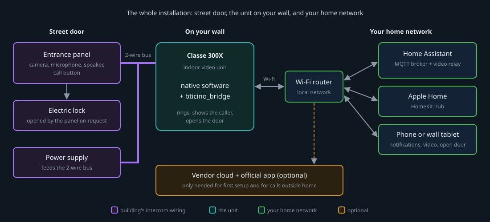
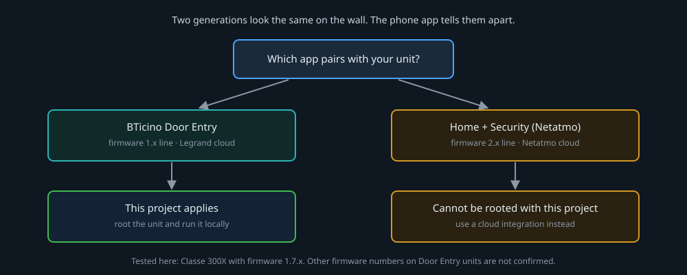
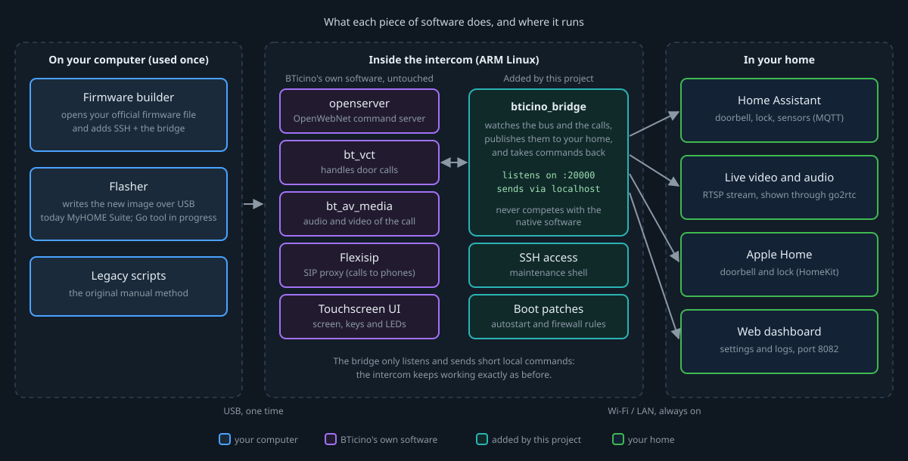
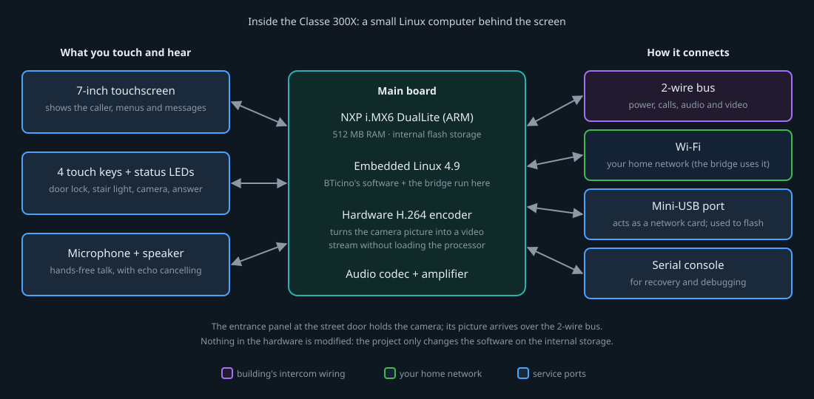

# BTicino Classe 300X — rooted firmware for Home Assistant

Run your BTicino Classe 300X video door entry unit with
[Home Assistant](https://www.home-assistant.io/) — get the doorbell, see and
hear the caller, and open the door from your own home network, without
depending on the vendor's phone app.

The project does two things:

1. It turns the **official firmware you already own** into a rooted image, so
   you can log in to the unit.
2. It gives you a **bridge** that runs on the unit and presents it to Home
   Assistant, Apple Home and a web dashboard.

## Is this for my unit?

Two generations of these intercoms look the same on the wall. The phone app
that pairs with the unit tells them apart:

| Your app | What it means | What to use |
| --- | --- | --- |
| **BTicino Door Entry** | Firmware 1.x line, Legrand cloud | This project |
| **Home + Security** (Netatmo) | Firmware 2.x line, Netatmo cloud | A cloud integration such as [`bticino_intercom`](https://github.com/k-the-hidden-hero/bticino_intercom) — this project does not apply |

### Model status

| Model | Rooted image | Flashing | Bridge in Home Assistant |
| --- | --- | --- | --- |
| Classe 300X (firmware 1.7.x) | yes, with the [legacy builder](legacy/README.md) | with MyHOME Suite (Windows) today; a Go flasher is in development | yes |
| Classe 100X | the legacy builder has a 100X option; not validated here | not validated here | not validated here — see [related projects](#related-projects) |

Tested here on a Classe 300X13E (hardware 2.0) with firmware 1.7.17 and 1.7.19.
Other firmware numbers reported on Door Entry units have not been confirmed.

## The software pieces

Each piece has one job, and runs in one of three places: on your computer
(once), inside the intercom, or in your home.

| Piece | What it does | Where it runs | Status |
| --- | --- | --- | --- |
| [Legacy builder](legacy/README.md) (`legacy/main.py`, `docker compose run bticino`) | Opens your official `.fwz`, adds SSH access (and optionally the MQTT scripts) and repacks it | Your computer | Works |
| MyHOME Suite (BTicino, Windows) | Writes the image to the unit over USB | Your computer | Works — the flashing path today |
| Go flasher | Same job as MyHOME Suite, cross-platform, with a verified backup first | Your computer | In development — not in this repository yet |
| On-the-fly builder | Builds the rooted image with the bridge already inside | Your computer | In development — not in this repository yet |
| [`bticino_bridge/`](bticino_bridge/README.md) | Watches the intercom and publishes it to Home Assistant (MQTT), Apple Home (HomeKit), a web dashboard and an RTSP video stream; takes commands back | Inside the intercom | Works on a rooted unit |
| [`patches/`](patches/) | Starts the bridge at boot and opens the firewall for it | Inside the intercom | Works |
| [`mqtt_scripts/`](mqtt_scripts/README.md) | The original, lighter integration: shell scripts that forward bus events to MQTT | Inside the intercom | Works — alternative to the bridge |
| BTicino's own software | Rings, shows the caller, opens the door, talks to the vendor cloud | Inside the intercom | Left untouched |

The bridge is designed not to interfere: it only listens to the intercom's
internal bus and sends short local commands, so the unit keeps working exactly
as before.

More on what the bridge replaces from the phone app, and what still needs the
cloud: [app versus bridge](docs/app-vs-bridge.md).

## The hardware

The Classe 300X is a small Linux computer behind a touchscreen. The project
changes only the software on its internal storage; nothing is opened or
soldered.

| Part | What it is for |
| --- | --- |
| Main board (NXP i.MX6 DualLite, 512 MB RAM, Linux 4.9) | Runs BTicino's software and, after rooting, the bridge |
| Hardware H.264 encoder | Turns the entrance-panel picture into a video stream |
| 7-inch touchscreen, 4 touch keys, LEDs | The normal use of the intercom |
| Microphone and speaker | Hands-free conversation |
| 2-wire bus | Power, calls, audio and video from the entrance panel |
| Wi-Fi | Connects the unit to your home network — the bridge uses it |
| Mini-USB port | Shows up on your computer as a network card; used for flashing |
| Serial console | Recovery and debugging |

## How to get there

**Today**

1. **Get the official firmware** for your unit and check it against the
   [known-good hashes](hashes/README.md). This project never ships firmware —
   see [bring your own firmware](docs/bring-your-own-firmware.md).
2. **Build a rooted image** with the [legacy builder](legacy/README.md).
3. **Flash it over USB** with MyHOME Suite, following the
   [legacy method](legacy/README.md). Read the
   [threat model](THREAT_MODEL.md) first: flashing can brick the unit.
4. **Install the bridge** on the rooted unit and connect it to Home Assistant:
   [`bticino_bridge/`](bticino_bridge/README.md).

**Where the project is heading**

One local build that already contains the bridge, flashed without MyHOME Suite,
ready for Home Assistant on first boot:

More diagrams (flasher protocol, builder pipeline, cloud-survival mode) are in
[`docs/`](docs/README.md).

## Known problems

- **MyHOME Suite says "The selected service pack is not suitable for updating
  the device."** — see
  [issue #43](https://github.com/fquinto/bticinoClasse300x/issues/43). Check
  that the firmware version selected in MyHOME Suite is 1.7; some hardware
  revisions are still rejected and this is being investigated.
- **SSH stops answering after some days** — see
  [issue #52](https://github.com/fquinto/bticinoClasse300x/issues/52).
- **Windows loses the USB network driver in the middle of a flash** — see
  [issue #62](https://github.com/fquinto/bticinoClasse300x/issues/62).

## What is in this repository

| Path | What it is |
| --- | --- |
| [`bticino_bridge/`](bticino_bridge/README.md) | The Home Assistant bridge |
| [`legacy/`](legacy/README.md) | The builder and the MyHOME Suite flashing method |
| [`patches/`](patches/) | Boot integration for the bridge |
| [`mqtt_scripts/`](mqtt_scripts/README.md) | The script-based MQTT integration |
| [`hashes/`](hashes/README.md) | Checksums of official firmware (no firmware itself) |
| [`docs/`](docs/README.md) | Guides, diagrams, protocol and command reference |

## Related projects

Independent community projects for the same family of intercoms:

| Project | For | What it is |
| --- | --- | --- |
| [`intercom-firmware-tool`](https://github.com/jorgeavlobo/intercom-firmware-tool) (jorgeavlobo) | 300X / 100X, firmware 1.x | Firmware tool with a Windows-friendly flow |
| [`bticino-classe100x-ha`](https://github.com/jorgeavlobo/bticino-classe100x-ha) (jorgeavlobo) | 100X | A lighter Classe 100X ↔ Home Assistant integration |
| [`bticino-c100x-firmware-tools`](https://github.com/daniel-sc/bticino-c100x-firmware-tools) (daniel-sc) | 100X, firmware 1.x | Builds and flashes without MyHOME Suite |
| [`c300x-controller`](https://github.com/slyoldfox/c300x-controller) (slyoldfox) | 300X / 100X, firmware 1.x | The long-standing on-device controller |
| [`ha-bticino-c300x`](https://github.com/memphi2/ha-bticino-c300x) (memphi2) | 300X, firmware 1.7.x | Home Assistant integration with an on-device agent |
| [`BTicino-GO-Companion`](https://github.com/r0bb10/BTicino-GO-Companion) (r0bb10) | 100X, firmware 1.x | On-device companion with a Home Assistant integration |
| [`bticino_intercom`](https://github.com/k-the-hidden-hero/bticino_intercom) (k-the-hidden-hero) | Firmware 2.x, Netatmo cloud | Cloud integration, no firmware modification |
| [`bticino-hometouch-homekit`](https://github.com/bubez81/bticino-hometouch-homekit) (bubez81) | HomeTouch | HomeKit / Home Assistant for the HomeTouch panel |

This project aims to coordinate with, not duplicate, that work.

## Device integration reference

- [OpenWebNet commands and discovery](docs/openwebnet-commands.md) — the known
  command/notification table and how to find new ones.

## Safety, legality, and license

- You bring your own firmware; this project does not host or redistribute
  BTicino images. See [`docs/bring-your-own-firmware.md`](docs/bring-your-own-firmware.md).
- Flashing can brick the unit, and cloud-survival disables vendor OTA. Read
  [`THREAT_MODEL.md`](THREAT_MODEL.md) before flashing.
- How the project was built, without proprietary code or firmware:
  [`CLEANROOM.md`](CLEANROOM.md). To report a security issue: [`SECURITY.md`](SECURITY.md).
- Licensed under the GNU GPL v2 — see [`LICENSE`](LICENSE).

## Support this work

If it helped you, donations keep the development going:
[PayPal](https://www.paypal.com/donate/?business=XQQJHGVPHLD7W&no_recurring=0&item_name=Thank+you+for+collaborating+and+helping+the+development+of+software+improvements.&currency_code=EUR)

## Origin

This work grew out of the community Telegram channel:
https://t.me/bTicinoClasse300x
