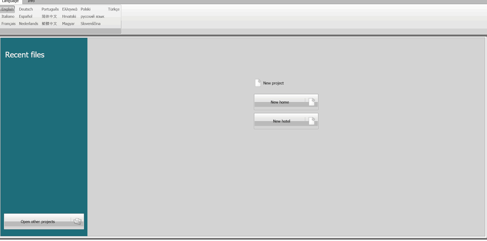

# Legacy builder and flashing method

This is the original way to get root on a Classe 300X: a script rebuilds an
official `.fwz` with SSH access, and BTicino's MyHOME Suite (Windows) flashes
it over USB.

**It is still the working path today.** The Go flasher and the on-the-fly
builder described in the top-level `README.md` are in development; until they
land, use the steps below. Nothing in this directory ships firmware: you bring
your own `.fwz`.

Read the [threat model](../THREAT_MODEL.md) first. Flashing can brick the unit.

## 1. Build the rooted image

You need Linux with Docker, or Python 3 with `sudo` (the script loop-mounts the
firmware's root filesystem, so it needs root).

From the **repository root**:

```sh
git clone https://github.com/fquinto/bticinoClasse300x.git
cd bticinoClasse300x
docker compose run bticino
```

Without Docker:

```sh
python3 -m pip install -r requirements.txt
sudo python3 legacy/main.py
```

The script asks a few questions and then does everything by itself:

- **Model and firmware version** — C300X (1.7.17 or 1.7.19) or C100X (1.5.x).
  It downloads the official firmware from the vendor, or uses the file you
  already have.
- **Root password** and whether to install an **SSH key**.
- Whether to remove the **signature files**.
- Whether to add the **MQTT scripts** ([`mqtt_scripts/`](../mqtt_scripts/README.md)).

The result is saved as `custom_firmware/NEW_<model>_<version>_<date>.fwz`.
Check the official file against the [known-good hashes](../hashes/README.md)
before building.

## 2. Flash it with MyHOME Suite

1. Take the unit off the wall bracket and connect its mini-USB port to a
   Windows computer. It shows up as a USB network card.
2. In MyHOME Suite, pick the device, move it to the working area, and select
   firmware version **1.7** for it.
3. Choose "update firmware", select the `.fwz` you built, and let it run to the
   end. The unit reboots during the process; do not unplug it.



Known problems:

- "The selected service pack is not suitable for updating the device." — see
  [issue #43](https://github.com/fquinto/bticinoClasse300x/issues/43).
- Windows loses the USB network driver when the unit reboots mid-flash — see
  [issue #62](https://github.com/fquinto/bticinoClasse300x/issues/62).

## 3. Log in

After the flash, the unit answers SSH on your network as user `root2`, with
the password (or key) you chose. Do not keep the default password the script
suggests. From there you can install the
[bridge](../bticino_bridge/README.md).

## What else is in this folder

- [`old_information.md`](old_information.md) — the fully manual method: unpack
  the `.fwz`, edit the ext4 root filesystem by hand, repack.
- `unpack01_fwz.sh`, `unpack02_btweb-ext4.sh`, `pack01_btweb-ext4.sh`,
  `pack02_fwz.sh` — the shell helpers for that manual method.
- `bticino.py`, `diagnose_mqtt.py` — small OpenWebNet and MQTT diagnostic tools.
- [`firmware_versions.md`](firmware_versions.md),
  [`CompareFirmwareVersions.md`](CompareFirmwareVersions.md),
  [`samples_json.md`](samples_json.md) — reference notes.
